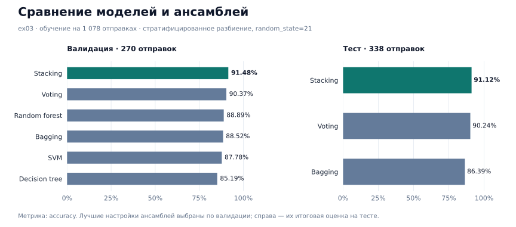

# Предсказание дня недели: модели и ансамбли

Учебный ML-проект. По пользователю, лабораторной работе, числу попыток и часу отправки модель определяет день недели. В проекте пройден путь от экспериментов с регуляризацией до сравнения ансамблей и оформления обработки данных в классы и `Pipeline`.

**Стек:** Python · pandas · NumPy · scikit-learn · Jupyter · tqdm · joblib.

## Данные и задача

В [исходном датасете](src/data/checker_submits.csv) — **1 686 отправок, 30 пользователей и 11 лабораторных работ**. Целевая переменная — один из семи дней недели: от понедельника (`0`) до воскресенья (`6`).

- `uid`, `labname` — категориальные признаки, преобразованные через One-Hot Encoding.
- `numTrials` — число попыток отправки задания.
- `hour` — час, извлечённый из `timestamp`.
- `dayofweek` — целевая переменная, также извлечённая из времени отправки.

После извлечения признаков `timestamp` удаляется, а целевая колонка отделяется от матрицы признаков. В `ex00` используется подготовленная версия данных с масштабированными числовыми признаками, в остальных экспериментах — без масштабирования.

## Что реализовано

| Этап | Блокнот | Содержание |
|---|---|---|
| Регуляризация | [00_regularization.ipynb](src/ex00/00_regularization.ipynb) | Сравнение вариантов регуляризации логистической регрессии, параметра `C` у SVM и ограничений сложности деревьев и леса. Стратифицированная кросс-валидация. |
| Подбор параметров | [01_gridsearch.ipynb](src/ex01/01_gridsearch.ipynb) | `GridSearchCV` для SVM, дерева и случайного леса; ручной перебор с `ParameterGrid`, `cross_val_score` и прогрессом через `tqdm`. |
| Метрики | [02_metrics.ipynb](src/ex02/02_metrics.ipynb) | Accuracy, weighted precision и recall, weighted ROC AUC по схеме One-vs-One. Общая функция оценки моделей и анализ ошибок по группам. |
| Ансамбли | [03_ensembles.ipynb](src/ex03/03_ensembles.ipynb) | Подбор режима и весов Voting, параметров Bagging, числа разбиений и `passthrough` для Stacking. Выбор настроек на валидации. |
| Pipeline и ООП | [04_pipelines.ipynb](src/ex04/04_pipelines.ipynb) | Собственные преобразователи, разбиение выборки, классы выбора и финализации модели. Полный запуск от исходного CSV до сохранённого классификатора. |

## Результаты

### Отдельные модели — ex02

Обучение на **1 348 объектах**, тест — **338 объектов**. Разбиение стратифицированное, `random_state=21`; параметры взяты из `ex01`.

| Модель | Test accuracy | Weighted precision | Weighted recall | Weighted ROC AUC, OVO |
|---|---:|---:|---:|---:|
| SVM, RBF | 0.88757 | 0.89267 | 0.88757 | 0.97878 |
| Decision Tree | 0.89941 | 0.90098 | 0.89941 | 0.93954 |
| **Random Forest** | **0.93195** | **0.93387** | **0.93195** | **0.98975** |

Лучший результат в этом эксперименте — случайный лес: `n_estimators=100`, `max_depth=32`, `criterion="entropy"`.

### Ансамбли — ex03

Здесь выделена отдельная валидация: **1 078 объектов для обучения, 270 для валидации и 338 для теста**. Настройки выбираются по валидационной accuracy, при равенстве — по precision.



Лучший ансамбль — **Stacking** с `n_splits=3` и `passthrough=True`. Базовые модели — SVM, дерево и случайный лес; итоговая модель — логистическая регрессия с `liblinear` в обёртке `OneVsRestClassifier`.

Его accuracy на валидации — **0.91481**. На тесте: **accuracy 0.91124, precision 0.91306, recall 0.91124**.

В `ex02` и `ex03` разный объём обучающих данных, поэтому эти результаты представлены как отдельные эксперименты. Оценка выполнена на случайном стратифицированном разбиении учебного датасета.

### Итоговый workflow — ex04

`FeatureExtractor` извлекает временные признаки, `MyOneHotEncoder` кодирует категории, `TrainValidationTest` создаёт выборки. `ModelSelection` подбирает параметры с двухчастной кросс-валидацией и выбирает алгоритм по валидации. `Finalize` обучает выбранную модель, оценивает её на тесте и сохраняет через `joblib`.

Выбран **Random Forest: 50 деревьев, глубина 22, критерий Gini**. Accuracy на валидации — **0.90370**, на тесте — **0.91124**.

Сохранённая модель: [RandomForestClassifier_0.91124.sav](src/data/RandomForestClassifier_0.91124.sav). Она принимает подготовленную матрицу признаков; преобразование исходных данных находится в блокноте.

## Анализ ошибок

Для лучшего Stacking из `ex03` ошибки разобраны по дням недели, пользователям и лабораторным работам. По условию эксперимента процент рассчитан как **число ошибок на тесте в группе / число объектов этой группы во всём датасете × 100%**.

Наибольшие значения: понедельник — **6.62%**, `user_6` — **16.67%**, `lab03` и `lab03s` — **100%**. В каждой из двух последних групп всего по одному объекту, поэтому размер группы важен для интерпретации результата.

## Запуск

Проверенное окружение — **Python 3.14.7**. Версии библиотек зафиксированы в [requirements.txt](requirements.txt).

```bash
python3 -m venv .venv
source .venv/bin/activate
python -m pip install -r requirements.txt
```
